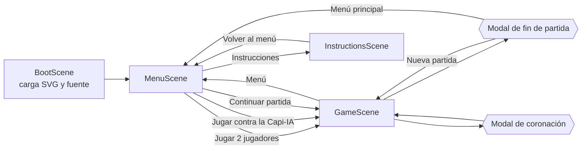
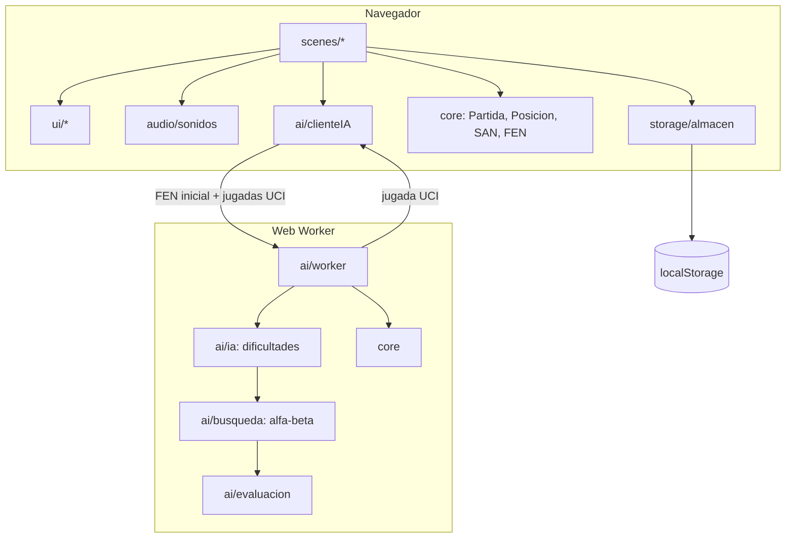

# Capi-Ajedrez 🌿♟️


**Capi-Ajedrez** es un ajedrez 2D completo en el que todas las piezas son capibaras.
Se juega en el navegador (móvil vertical, móvil horizontal o escritorio), con toque, clic o
arrastrando las piezas, contra otra persona en el mismo dispositivo o contra la **Capi-IA**.
Se puede instalar como aplicación (PWA) y funciona sin conexión.

| Pieza | Nombre temático | Accesorio |
| --- | --- | --- |
| Peón | Capibebé | Hojita verde (y un poco más pequeño) |
| Torre | Capi-Torre | Sombrero de torre almenada gris |
| Caballo | Capi-Caballero | Casco gris con plumero rojo |
| Alfil | Capi-Obispo | Mitra morada con cruz blanca |
| Dama | Reina Capibara | Corona dorada con gemas rojas |
| Rey | Rey Capibara | Corona grande con cruz y gema azul |

Las **Claras** (pelaje beige) equivalen a las blancas y empiezan; las **Oscuras** (pelaje marrón)
equivalen a las negras.

## Características

- Reglas completas: enroque corto y largo con todas sus condiciones, captura al paso,
  coronación a elección, jaque, jaque mate, rey ahogado y tablas por material insuficiente,
  triple repetición y regla de los 50 movimientos.
- Historial en notación algebraica (mostrada en notación española: R, D, T, A, C).
- Capi-IA en un Web Worker con tres dificultades: Fácil, Medio y Difícil.
- Relojes opcionales de 5 o 10 minutos por bando.
- Deshacer (contra la IA deshace tu jugada y su respuesta), girar tablero, sonido on/off.
- Guardado automático en `localStorage` y botón «Continuar partida».
- Animaciones: piezas que se deslizan, rebote al seleccionar, capturas con partículas,
  sacudida en jaque, fundidos entre escenas y confeti en el jaque mate.
- Sonidos sintetizados con WebAudio (sin archivos de audio).
- Manual de instrucciones en pestañas y páginas.

## Tecnologías

| Herramienta | Uso |
| --- | --- |
| [Phaser 3.90](https://phaser.io/) | Motor 2D (única dependencia de ejecución) |
| TypeScript 5.9 (modo estricto) | Lenguaje |
| Vite 8 | Servidor de desarrollo y empaquetado |
| Vitest 5 | Tests del motor de reglas y de la IA |
| Web Workers | La IA calcula sin bloquear la interfaz |
| WebAudio | Efectos de sonido sintetizados |
| Service Worker + Web App Manifest | PWA instalable y offline (hechos a mano, sin plugins) |
| `@resvg/resvg-js` (solo desarrollo) | Generar los PNG de los íconos a partir del SVG |

## Cómo ejecutarlo

Requisitos: Node.js 20 o superior.

```bash
npm install        # instala dependencias
npm run dev        # servidor de desarrollo en http://localhost:5173
npm test           # tests de reglas (perft) y de la IA
npm run build      # comprobación de tipos + build de producción en dist/
npm run preview    # sirve el build de producción (con service worker)
```

Scripts auxiliares (los archivos generados ya están en el repositorio):

```bash
npm run piezas     # regenera los SVG de las piezas, el logo y los íconos de la interfaz
npm run iconos     # regenera los íconos PNG de la PWA a partir del Rey Capibara
```

### Despliegue

El proyecto está preparado para Vercel (`vercel.json`). Con el CLI autenticado:

```bash
npx vercel --prod
```

URL de producción: **https://capi-ajedrez.vercel.app**

## Arquitectura

```
src/
  core/      lógica pura del ajedrez, sin Phaser (tablero, movimientos, reglas, FEN, SAN)
  ai/        evaluación, búsqueda, worker y cliente del worker
  scenes/    BootScene, MenuScene, InstructionsScene, GameScene (el fin de partida es un modal)
  ui/        botones, selectores, modales, panel de historial y tema visual
  audio/     sonidos sintetizados con WebAudio
  storage/   partida y preferencias en localStorage
  pwa/       plantilla del service worker
tests/       tests de core (perft y reglas) y de ai
scripts/     generadores de SVG e íconos
public/      piezas SVG, logo, íconos y manifest
```

### Flujo de escenas



### Módulos



### El motor de reglas (`src/core`)

- **Tablero**: arreglo de 64 casillas (`Int8Array`, a1 = 0 … h8 = 63). Cada pieza es
  `color | tipo` (claras = 0, oscuras = 8). Los ataques usan tablas precalculadas de saltos
  (caballo, rey, peón) y rayos (piezas deslizantes).
- **Hacer/deshacer**: `Posicion.hacer()` guarda en una pila los datos irreversibles
  (enroques, al paso, contador de 50 movimientos, hash) y `deshacer()` los restaura.
- **Legalidad**: se generan movimientos pseudo-legales y se descartan los que dejan al rey en
  jaque. El enroque además comprueba que el rey no esté en jaque ni pase o caiga en casillas atacadas.
- **Zobrist**: dos claves de 32 bits (64 bits efectivos) actualizadas incrementalmente; sirven para la
  triple repetición y para la tabla de transposición de la IA.
- **`Partida`**: envuelve la posición con el historial en SAN, el resultado (mate, ahogado y tablas),
  las capturas, la ventaja de material y la reconstrucción desde «FEN inicial + jugadas UCI».

## Cómo se verificaron las reglas (perft)

*Perft* cuenta todas las posiciones alcanzables a una profundidad dada. Comparar esos números con
los valores de referencia de la comunidad de programación de ajedrez es la forma estándar de
demostrar que el generador de movimientos es correcto (enroques, al paso, coronaciones, clavadas
y jaques descubiertos incluidos). Además, cada test comprueba que, después de hacer y deshacer
todos esos movimientos, el FEN vuelve a ser exactamente el inicial.

| Posición | d1 | d2 | d3 | d4 | d5 |
| --- | --- | --- | --- | --- | --- |
| Inicial | 20 | 400 | 8 902 | 197 281 | — |
| Kiwipete `r3k2r/p1ppqpb1/bn2pnp1/3PN3/1p2P3/2N2Q1p/PPPBBPPP/R3K2R w KQkq -` | 48 | 2 039 | 97 862 | 4 085 603 * | — |
| Posición 3 `8/2p5/3p4/KP5r/1R3p1k/8/4P1P1/8 w - -` | 14 | 191 | 2 812 | 43 238 | 674 624 * |

\* Profundidades extra, más allá de las exigidas. Todas pasan.

También hay tests puntuales de: mate del pastor, rey ahogado, enroque bloqueado por casilla
atacada / en jaque / con piezas en medio / tras mover rey o torre, captura al paso (incluida la
prohibida por clavada horizontal y la que caduca), coronación a las cuatro piezas, SAN con
desambiguación por columna, fila y casilla completa (y sin desambiguar si la otra pieza está
clavada), triple repetición, regla de los 50 movimientos (con prioridad del mate), material
insuficiente, tiempo agotado contra material insuficiente, FEN de ida y vuelta, y coherencia del
hash incremental.

**Resultado actual de `npm test`: 57 tests en 3 archivos, todos en verde.**

## Cómo funciona la Capi-IA (`src/ai`)

1. **Evaluación** (`evaluacion.ts`): material (P = 100, C = 320, A = 330, T = 500, D = 900) más
   tablas de posición por pieza (*piece-square tables*). La tabla del rey se interpola entre
   medio juego (refugio) y final (centralización) según la fase de la partida. En finales muy
   ganados se premia arrinconar al rey rival y acercar el propio, para que sepa dar mate.
2. **Búsqueda** (`busqueda.ts`): negamax con poda **alfa-beta**, extensión de jaque, poda por
   distancia de mate y detección de repeticiones y de la regla de los 50 en el árbol.
   - **Ordenamiento**: primero la jugada de la tabla de transposición, después capturas por
     **MVV-LVA** (víctima más valiosa, atacante menos valioso), coronaciones, *killer moves* e
     historia.
   - **Búsqueda de quietud**: en las hojas sigue explorando capturas y coronaciones para no evaluar
     en mitad de un intercambio.
   - **Tabla de transposición** de 2¹⁸ entradas con arreglos tipados.
   - **Profundización iterativa** con límite de tiempo: si se acaba el tiempo a mitad de una
     iteración, se usa la mejor jugada ya comprobada.
3. **Dificultades** (`ia.ts`):
   - **Fácil**: elige al azar, salvo que el rival «regale» una pieza (una captura que no se puede
     recuperar o que gana material claramente), en cuyo caso la captura.
   - **Medio**: búsqueda a profundidad 2 (más quietud y extensión de jaque).
   - **Difícil**: profundización iterativa durante ~1,5 s. Alcanza unas 6–9 jugadas de
     profundidad (~700 000 nodos por segundo en un portátil) y encuentra mates cortos.
4. **Worker** (`worker.ts` y `clienteIA.ts`): el hilo principal envía el FEN inicial y la lista
   de jugadas en UCI; el worker reconstruye la partida (así conoce las repeticiones) y responde
   con la jugada. La interfaz espera al menos 0,7 s antes de mostrarla, para que se sienta natural,
   y bloquea el tablero mientras tanto («La Capi-IA está pensando…»).

Tests de la IA: mates en 1 (con ambos colores), dos mates en 2 (verificados por fuerza bruta: tras
la jugada de la IA, cualquier respuesta permite un mate en 1), defensa de la dama atacada,
captura de una pieza regalada en fácil, y legalidad de las jugadas en posiciones aleatorias.

## Decisiones tomadas

- **Resolución virtual**: el juego usa `Scale.FIT` con dos tamaños virtuales, 1600×900 en
  horizontal y 900×1600 en vertical. Al girar el teléfono se cambia el tamaño y la escena se
  reconstruye conservando la partida, los relojes y la pestaña del manual.
- **Tamaños táctiles**: los controles miden al menos 104 unidades; en un teléfono de 390 px de
  ancho eso son unos 45 px CSS (mínimo recomendado: 44 px).
- **Piezas capturadas en horizontal**: en vertical van literalmente encima y debajo del tablero; en
  horizontal el tablero ocupa todo el alto, así que van en las tarjetas superior e inferior del
  panel lateral, que siguen la orientación del tablero (al girarlo, se intercambian).
- **Notación**: internamente se usa la SAN internacional (K, Q, R, B, N), que es la que validan los
  tests. En pantalla se traduce a la notación española (R, D, T, A, C).
- **Tablas automáticas**: la triple repetición y la regla de los 50 movimientos terminan la partida
  automáticamente (no hace falta reclamarlas), para simplificar la interfaz.
- **Repetición y al paso**: la casilla de al paso solo cuenta para la repetición si algún peón
  puede capturar realmente, como dice el reglamento.
- **Reloj**: empieza a correr con la primera jugada de las Claras y corre también mientras piensa
  la IA. Si a un bando se le acaba el tiempo pero el rival no tiene material para dar mate, son
  tablas. En los últimos 10 segundos se muestran décimas.
- **Deshacer**: está permitido incluso tras el final de la partida (por ejemplo, para retirar el
  error que llevó al mate), salvo si terminó por tiempo. Se desactiva mientras piensa la IA.
- **Guardado**: se guarda el FEN inicial, las jugadas en UCI, el modo, la dificultad, los relojes
  y la orientación. Las partidas terminadas o sin jugadas no se guardan.
- **Piezas como SVG generados**: `scripts/generar-piezas.mjs` dibuja las 12 piezas con la misma
  cabeza de capibara y cambia el accesorio y la paleta, lo que garantiza coherencia. El archivo de
  la dama se llama `*-reina.svg` para seguir el nombre temático.
- **Audio**: el audio de Phaser está desactivado; todos los efectos (mover, capturar, jaque, enroque,
  coronar, victoria, derrota, tablas y clic) se sintetizan con osciladores y ruido filtrado.
- **Fuente**: Fredoka se carga desde Google Fonts. La pantalla de carga espera hasta 3,5 s a que
  esté lista y, si no hay conexión, sigue con fuentes redondeadas de respaldo.
- **PWA sin plugins**: un plugin propio de Vite (en `vite.config.ts`) genera `sw.js` con la lista
  exacta de archivos del build (incluidos los que llevan hash) y una versión nueva en cada build.
  El service worker usa `ignoreVary` al buscar en la caché: sin eso, los scripts de módulo (que
  envían la cabecera `Origin`) no se encontraban sin conexión en servidores que responden con
  `Vary: Origin`. Este fallo se detectó y corrigió probando el modo offline en el navegador.
- **Íconos**: los PNG de 192 y 512 px (normales y *maskable*) y el `apple-touch-icon` se generan
  desde el SVG del Rey Capibara con `@resvg/resvg-js`, que solo es dependencia de desarrollo.

## Verificación realizada

En cada fase se ejecutaron `npx tsc --noEmit`, `npm test` y `npm run build`. Desde la fase 3 se
probó el juego en el navegador (Chrome/Edge con la extensión de Claude):

- Partida de 2 jugadores con clics y arrastre, enroque corto, capturas, jaque (casilla roja,
  aviso y sacudida), girar tablero, deshacer, guardado y «Continuar partida».
- Mate del pastor con modal y confeti; rey ahogado; tiempo agotado; coronación (incluida la
  subpromoción a caballo arrastrando la pieza).
- Partidas contra la Capi-IA en Fácil (captura la pieza regalada), Medio y Difícil (defiende el
  mate del pastor con …De7); deshacer doble contra la IA.
- Diseño vertical (430×900), horizontal y una ventana muy baja (836×348); cambio de orientación
  a mitad de partida.
- Build de producción: service worker activo, 38 archivos precargados y juego completo (incluida
  la IA) funcionando con el servidor apagado.
- Consola sin errores durante todas las pruebas.

## Despliegue realizado

🌐 **https://capi-ajedrez.vercel.app**

Desplegado con `npx vercel --prod` (Vercel ejecuta `npm run build` y publica `dist/`). Se
comprobó en producción que la página, el manifest, los íconos y `sw.js` responden con 200, que
el service worker queda activo y que se puede jugar contra la Capi-IA. Para instalarla en Android,
abre la URL en Chrome y elige «Instalar aplicación» (o «Añadir a pantalla de inicio»).
